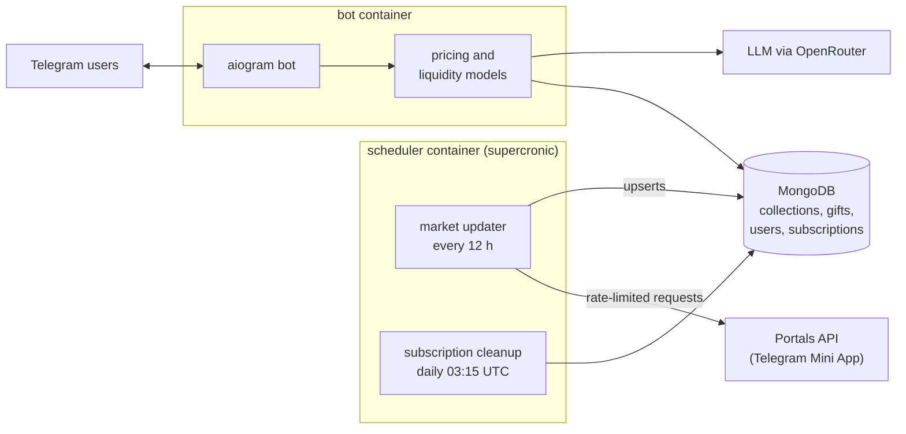

# Giftalyzer

Giftalyzer is a Telegram bot that tells collectors what a Telegram Gift is worth. Telegram Gifts are collectible NFTs on the TON blockchain, bought and sold on several third-party marketplaces, and each gift has traits (model, symbol, backdrop) that make some copies far rarer than others. Prices for the same kind of gift vary a lot between markets and change by the hour, so it's hard to tell whether a listing is a bargain.

Giftalyzer collects live listings from the Portals marketplace, keeps them in one database, and compares each gift with similar gifts, its collection's floor price and recent sales to estimate a fair price. I built it as CTO of Giftalyzer and ran it from June to October 2025, when it had more than 350 active users. It is no longer maintained.

The repository is mostly about the data collection: keeping an accurate copy of an external market that rate-limits, expires sessions and sometimes returns bad responses, without letting a bad response corrupt the data.

## System overview



Everything is async Python (asyncio, aiohttp, Motor). The bot and the scheduler are two Docker containers built from the same code. GitHub Actions builds both images and pushes them to Docker Hub on every push to `main`, and `docker-compose.yml` runs them on the server.

## How a market update works

The updater (`scripts/db_updater.py` → `data_collection/portals/parser.py`) runs one full pass over the market:

1. **Authenticate.** Portals runs as a Telegram Mini App, so there is no API key. The collector signs in with a Telegram user session (Pyrogram), requests the Mini App's web view and takes the signed launch data as its auth token (`data_collection/auth.py`). Getting a token is retried with exponential backoff.
2. **List the collections** and count each one's listings.
3. **Fetch the listings, split to fit the API's limits.** The listings endpoint pages in steps of 50 and stops at an offset of 600, so a large collection can't be read in one paged scan.
   - A collection under 500 listings is scanned page by page.
   - A larger collection is split by model. Each model is probed for its size, and small models are scanned in full.
   - A model that is still too large is split again: the collector finds which backdrops are listed for that model and fetches each (model, backdrop) pair separately.
4. **Write to MongoDB.** Each gift is one document with a sub-document per market (`markets.portals`), so another market can be added without changing the schema. Before writing a fresh scan of a collection or model, the collector clears that market's prices for it and then upserts what it just saw, so gifts that were sold or delisted lose their old price. A final cleanup removes gifts that are no longer listed on any market.

Names are normalised (`mongo.py`) so a gift looked up by name, ID or Telegram link matches its record.

`data_collection/tonnel/` is a separate script that reads collection floor prices from the Tonnel marketplace with a headless browser (Playwright). It isn't part of the scheduled update.

## Staying correct when the source misbehaves

Most of the engineering effort went here. The marketplace wasn't built for this kind of client, so the collector assumes any response can be wrong.

- **Rate limiting on my side.** Every request waits for a token from a token bucket (3 requests a second by default) plus a small base delay with random jitter, so the collector never sends bursts.
- **Backing off on 429s.** A 429 response counts as a strike. The collector honours `Retry-After` when it is sent and otherwise waits with an exponential delay plus jitter. Three strikes trigger a global 15-minute cool-down that pauses every request, and successful responses slowly clear the strikes. Server errors (500 to 504) and network errors are retried a limited number of times.
- **An empty response is treated as suspicious.** If a collection that normally has listings suddenly returns none, the most likely cause is an expired session, not an empty market. The collector refreshes the session and retries once. If the result is still empty, it **keeps the existing data** instead of wiping it and pauses that collection for a while. Without this rule one bad response would delete a collection's prices from the bot.
- **Everything is configurable.** Bucket size, delays, jitter, cool-down length, strike threshold and size thresholds are all `PORTALS_*` environment variables, so the collector could be slowed down without a code change when the market tightened its limits.
- **No overlapping runs.** The scheduler starts the updater under `flock`, so a slow pass can't overlap the next one.
- **Logging** goes to stdout in a consistent format, with clear markers for cool-downs, refreshes and preserved data, so problems showed up in the container logs.

## Pricing a gift

- `analyser/price_analyser.py` picks a reference price from the listing, the last sale, the collection floor and the best offer, then adjusts it for the gift's backdrop, its rarity within the collection and how active the collection's market is.
- `analyser/collections_liquidity.py` scores how easily a collection's gifts sell, using prices, floors and how long items stay listed.
- `analyser/forecaster.py` turns the result into the message the user sees: how far the listing is from the estimate, a rarity percentage, a liquidity label and a short 30-day outlook. The outlook text is generated by an LLM through OpenRouter (`analyser/model_provider.py`), from the numbers the model computed.
- `analyser/stars_collection.py` evaluates gifts priced in Telegram Stars from their supply and price.

## The bot

The bot (`bot_manager/`) is built on aiogram 3 with finite-state machines for multi-step flows.

- **Gift check:** send a gift's ID, name or link and get its listed price, the estimate, rarity and liquidity.
- **Market search:** browse listings by collection, model and backdrop, with paging.
- **AI requests:** pick a question, then a collection, models and backdrops (or paste a gift link), and get an analysis of the matching gifts.
- **Subscriptions** are paid in Telegram Stars and expire automatically. **Promo codes** give a discount and can pay a share of each sale to the code's owner.
- **Support tickets** are forwarded to a staff group chat, admins get their own menu, payment and admin events go to a logs chat, and a global error middleware handles failures such as users blocking the bot.
- The whole interface is available in English and Russian.

## Project layout

```
manager.py            entry point: run-bot, update-forever, check-subscriptions
main.py               starts the bot
data_collection/      Telegram auth, Portals collector, standalone Tonnel floor reader
mongo.py              data layer: indexes, name normalisation, upserts, cleanup
analyser/             pricing, liquidity, forecast and AI analysis
bot_manager/          handlers, keyboards, FSM states, middleware (i18n, errors, dev guard), texts (en, ru)
subscription/         subscription storage and expiry
scripts/              market updater, subscription check, MongoDB export tools
Dockerfile            bot image
Dockerfile.scheduler  scheduler image (supercronic + crontab)
.github/workflows/    builds and pushes both images
```

## Running it

You need Python 3.12, MongoDB, a Telegram bot token and Telegram API credentials.

```bash
pip install -r requirements.txt
playwright install chromium
```

Create a `.env` file:

| Variable | Purpose |
|---|---|
| `BOT_API` | Telegram bot token |
| `MONGO_URI` | MongoDB connection string |
| `API_ID`, `API_HASH` | Telegram API credentials for the user session |
| `TELEGRAM_PHONE` | phone number for the user session login |
| `TG_SESSION_PATH` | where the Pyrogram session file is stored |
| `API_URL_PORTALS`, `API_URL_TONNEL` | marketplace API addresses |
| `API_KEY_OPENROUTER` | key for the LLM-written outlook |
| `SUPPORT_GROUP_ID`, `LOGS_GROUP_ID` | group chats for support tickets and payment/admin logs |
| `PORTALS_*` | optional collector tuning (rate limits, cool-downs, thresholds) |

Then start the parts you need:

```bash
python -m manager run-bot
python -m manager update-forever
python -m manager check-subscriptions
```

Or run both containers with `docker compose up -d`.

The first collector run asks you to log in to Telegram and creates the session file. Session files contain login keys, so `*.session` is in `.gitignore` and must never be committed.

## What I'd do differently

I built this quickly for a fast-moving market, and some parts show it.

- There are no automated tests. The rate limiter, the retry logic and the "keep data on an empty response" rule are the first things I'd cover, since a regression there silently damages the data.
- The token bucket and HTTP helper are copied between two collector files instead of living in one shared module.
- `requirements.txt` includes packages the project doesn't use, such as pygame and Jupyter.
- Some comments and user-facing strings are only in Russian.
